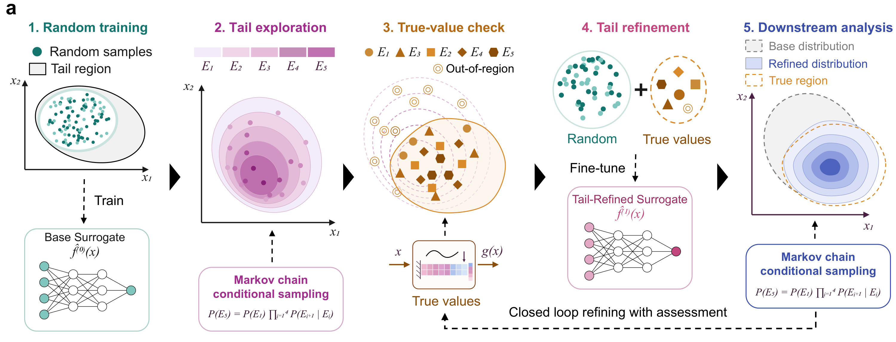
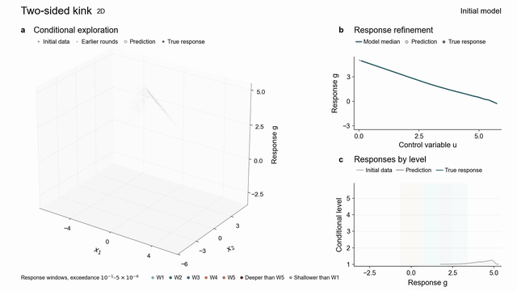

# Learning to generalize in the tails through active exploration

The method uses model rankings to generate conditional tail candidates, obtains true responses at selected inputs, and retains labels from all levels for cumulative model refinement.



## Contents

- Five benchmarks: two-sided kink, radial kink, tail kink, hysteretic oscillator and cantilever beam
- Learning-method comparisons and external baseline adapters
- Three-dimensional slope models, sliding-body reconstruction and conditional GED calibration in `slope/`
- Recorded inputs, true responses and model predictions for Supplementary Videos 1–5

## Repository layout

```text
main.py                         benchmark entry point
benchmarks/cases/               response functions and case settings
benchmarks/protocol/            conditional sampling, acquisition and model updates
benchmarks/uncertainty_benchmark/ learning-method comparisons
benchmarks/external_adapters/   external baseline adapters
data/common_data/              benchmark samples
data/references/               response thresholds and normalization scales
data/inputs/                   recorded model inputs
data/supplementary_videos/     video inputs, true responses and five-stage predictions
slope/                         slope code, configurations and model weights
assets/                        figure panel and animation preview
environment.json               recorded experiment environment
requirements.txt               pinned Python dependencies
LICENSE                        MIT licence
```

## Installation

Use Python 3.11. From the repository root, create a virtual environment:

```bash
python -m venv .venv
```

Activate it on Linux or macOS:

```bash
source .venv/bin/activate
```

On Windows PowerShell:

```powershell
.\.venv\Scripts\Activate.ps1
```

Install the benchmark dependencies:

```bash
python -m pip install -r requirements.txt
```

The recorded experiment environment is provided in `environment.json`, and `requirements.txt` pins the dependency versions used for the benchmark runs.

PyTorch models select CUDA when available and otherwise use the CPU. Set `DEVICE=cpu` or `DEVICE=cuda` to choose explicitly. Instructions and additional dependencies for the slope models are in [`slope/README.md`](slope/README.md).

## Run a benchmark

Inspect the two-sided kink configuration and query budget:

```bash
python main.py two-sided-kink --organisation tail_holdout --stages 4 --replicates 1 --dry-run
```

This command prints the resolved settings and exits before response evaluation or model training.

Run four rounds for one independent replicate:

```bash
python main.py two-sided-kink --organisation tail_holdout --stages 4 --replicates 1 --out results/two-sided-kink
```

The output directory contains:

| File | Content |
|---|---|
| `level_table.csv` | Per-level response thresholds, prediction errors and other recorded scores |
| `aggregate.csv` | Aggregated scores for the run |
| `manifest.json` | Settings, random seed, reference thresholds, query counts and execution environment |

Checkpoints default to `/tmp/protocol_checkpoints`. Set `PROTOCOL_CHECKPOINT_DIR` to a persistent directory to retain them.

Use the following case names with the same entry point:

| Problem | Case name |
|---|---|
| Two-sided kink | `two-sided-kink` |
| Radial kink | `radial-kink` |
| Tail kink | `tail-kink` |
| Hysteretic oscillator | `hysteretic-lab` |
| Cantilever beam | `cantilever_beam_2d` |

Case definitions are in `benchmarks/cases/<case>/problem.py`. Shared sampling and data settings are in `benchmarks/protocol/config.py`, and model recipes are in `benchmarks/protocol/surrogate.py`. Run `python main.py --help` for available options.

## Learning-method comparisons

The comparison runner uses 1,000 initial training inputs for each analytical problem and the beam, and 5,000 for the oscillator. The oscillator uses componentwise adaptive pCN. The common prediction networks are used for all seven fixed-budget methods.

Install the LCMD dependency:

```bash
git clone https://github.com/dholzmueller/bmdal_reg.git benchmarks/third_party/bmdal_reg
git -C benchmarks/third_party/bmdal_reg checkout af97eece7a513a2f3603e928c77e9e5d1c9ba7e9
```

Run one paired comparison block:

```bash
python compare.py two-sided-kink --block 0 --device cpu --out results/two-sided-kink/block_000
```

The default methods are `RAND-Replay`, `OURS-C`, `NN-QBC-Var-M5`, `QBC-LCB-k2`, `MC-Dropout-Var-T30`, `LCMD-TP-kgrad-sketch512` and `DIR-LDS-FDS`. Select a subset with `--methods`. Run blocks 0 through 9 for ten repetitions. Each method adds 500 training labels in each of four rounds. Auxiliary committees and dropout networks select queries. The final predictions use the common prediction network. DIR uses LDS and FDS during refinement. For the oscillator, LCMD uses Linear-layer gradients with the recurrent network retained for prediction.

Evaluate the saved common prediction networks on the fixed tail bands after training:

```bash
PYTHONPATH=benchmarks python -m uncertainty_benchmark.posthoc_evaluation two-sided-kink --block-dir results/two-sided-kink/block_000
```

This command reports the five normalized MAEs and their mean. The evaluation labels do not enter acquisition or training.

The files under `benchmarks/cases/*/sweep/` contain the frozen thresholds used by the comparison diagnostic. The separate files under `data/references/` define the common tail evaluation bands.

MF-AL uses the common initial data and fitted initial model saved by the paired runner:

```bash
PYTHONPATH=benchmarks python -m external_adapters.mf_al two-sided-kink --block 0 --shared-block results/two-sided-kink/block_000 --out results/mf-al/two-sided-kink/block_000
```

AK-SS requires an isolated Python environment with Python 3.11, OpenTURNS 1.20.post3, NumPy 1.26.4, SciPy 1.11.4 and psutil. Install `m-balesdent/otak` at version `15fa3a6` under `benchmarks/third_party/otak`. BSS requires MATLAB and the original STK/BSS runtime. Its source is `https://git.code.sf.net/p/kriging/contrib-bss`, version `574e083`. Build the BSS particle-replication helper for the target system.

```bash
PYTHONPATH=benchmarks python -m external_adapters.otak_runner tail-kink --block 0 --out results/ak-ss/tail-kink/block_000
PYTHONPATH=benchmarks python -m external_adapters.bss_cases.runner tail-kink --block 0 --out results/bss/tail-kink/block_000 --matlab /path/to/matlab
```

Evaluate a saved native endpoint with the same tail-error calculation:

```bash
PYTHONPATH=benchmarks python -m external_adapters.evaluate_native two-sided-kink --method MF-AL --run-dir results/mf-al/two-sided-kink/block_000
```

Use `--method AK-SS` or `--method BSS` for their saved endpoints. AK-SS evaluation uses its isolated OpenTURNS environment. BSS evaluation also requires `--matlab /path/to/matlab`.

The native-method limit is 50,000 additional response queries. Initial training labels are counted separately. The tail-kink response is implemented in both native adapters. BSS uses the same original-distribution initial inputs as the fixed-budget runner.

Run the code checks with:

```bash
python -m pytest tests/test_comparison_release.py
```

## Data

MC-Dropout results for the radial and tail kink problems are in `data/benchmark_results/`. Each problem has ten complete runs and four checkpoints per run. Acquisition uses dropout 0.1 and 30 stochastic forward passes. The result files contain band-wise errors, quantile errors and acquired-label counts on the common evaluation data. CPU runtime results are reported in `comparison_cpu_runtime_summary.csv` and `comparison_cpu_runtime_per_run.csv`. Timing includes initial model fitting, acquisition, true-response evaluation and refinement, and excludes initial label generation and common scoring.

`data/common_data/` contains the original-distribution, tail and integration samples for the five benchmarks. `data/references/` contains the response thresholds and normalization scales.

`data/supplementary_videos/` contains five NPZ files with 44,000 recorded sample rows, true responses, and predictions from the initial model and four refined models. Its README explains the array fields, and `manifest.json` records shapes and data types.

The three-dimensional slope dataset is archived at https://doi.org/10.5281/zenodo.24022582.

## Process



## Licence

Project code is distributed under the MIT License. The BSS-derived MATLAB files retain LGPL 2.1-or-later, and the DIR routines retain their authors' MIT License. See `LICENSE`, `THIRD_PARTY_NOTICES.md` and `licenses/`.

## Contact

Zongyu Zhang, jznv0338@Leeds.ac.uk  
Kaiwen Liu, kaiwen.liu@queensu.ca
